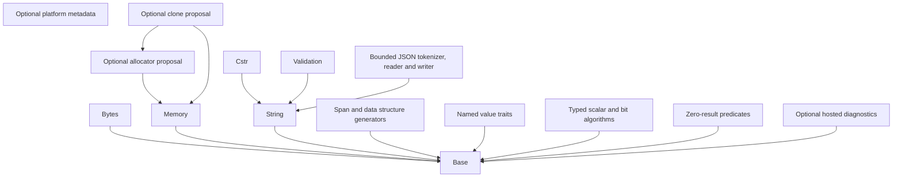

# Framework layers and naming

The dependency direction is from a consumer to its provider. This describes
development source organization, not deployment or standards qualification.

| Boundary | Canonical paths | Responsibility |
| --- | --- | --- |
| Compile-time foundation | `hps/base/all.h`, `hps/base/` | Compiler/language/architecture capabilities, standard type providers (`hps_bool.h`, `hps_stdint.h`, `hps_stddef.h`), fixed-work Boolean and expression helpers; no higher-layer dependencies |
| Platform metadata | `hps/platform/detection.h`, `hps/platform/` | Visible OS-family, libc and POSIX evidence; no OS/libc includes, runtime adapter or API guarantee |
| Hosted adapter | `hps/platform/hosted/debug.h` | Separately enabled stderr/assertion/abort adapter; no core dependency or no-heap claim |
| Typed scalar algorithms | `hps/algorithm/scalar.h`, `hps/algorithm/bits.h` | Single-evaluation extrema and checked bit operations; no implicit generic mutation |
| Result convention | `hps/result/check.h` | Zero/nonzero predicates only; no shared status type, codes, category or lookup |
| Raw memory and lifetime counters | `hps/memory/operations.h`, `hps/memory/array.h`, `hps/memory/refcount.h` | Byte operations, checked element counts and checked single-context reference arithmetic; no implicit destruction |
| Static byte reservations | `hps/memory/pool.h` | Single-context fixed byte-block ownership; no general typed-object allocation |
| Optional ownership proposals | `hps/memory/allocator.h`, `clone.h`, `allocated_array.h`, `owner.h` | Explicit providers, cloning, checked allocation and typed manual owners; HPS-MEM-001 disposition pending |
| Binary sequences | `hps/bytes/` | Borrowed views, capacity/length, cursor and integer codecs |
| Text values | `hps/string/all.h`, `hps/string/` | Counted views, bounded buffers/builders, delimiter-set tokenization, persistent indentation, ASCII and alphabet policy |
| C-string algorithms | `hps/cstr/all.h`, `hps/cstr/` | Bounded NUL-terminated transformations, parsing and formatting |
| Typed data structures | `hps/data_structure/define.h`, `operations.h`, `optional.h`, `all.h` | Caller-owned typed spans/descriptors, bounded vector/list operations, typed borrowed iterators and optional values; one descriptor provider |
| JSON syntax | `hps/json/all.h`, `hps/json/` | Strict lexical grammar, iterative caller-budgeted document reading and validated fixed-output writing; no heap object graph or generic format registry |
| Named values | `hps/enum/` | Imported enum traits and string-key generators with recorded legacy findings |
| Domain validation | `hps/validation/` | National-code validation over the String contract |

Memory operations and binary sequences are different contracts. The former
touches bytes in caller-proven live objects; the latter validates explicit
descriptor lengths/capacities and maintains logical state. String and Cstr also
retain their distinct counted-text and bounded-C-string contracts. Their existing
libc calls do not acquire a new pool or allocator dependency through this change.

`src/internal/text.h` is implementation-only shared text validation beneath String
and Cstr. Both modules use the same view/error contract; neither reaches into the
other's private directory. The helper implementation is unchanged.

Canonical public includes use `hps/<family>/<operation>.h`; family umbrellas use
`all.h`, while `platform/detection.h` aggregates only platform metadata. Every
implementation lives inside its family directory. The seven old root headers
(`base.h`, `cstr.h`, `string.h`, `span.h`, `data_structure.h`,
`hps_data_structure.h`, `hps_allocator.h`) are thin forwarding includes only.
No second compiler detection system or global runtime umbrella is introduced.
Public macros/constants use `HPS_`, C functions/types use `hps_` or the documented
caller-selected generator prefix. Allocator function/member names require the explicit
[draft migration](../migration/memory.md); the forwarding path does not preserve
the conflicting draft function signatures.

The allocator/clone headers are development proposals, individually included by
opting-in callers. They are not included by Base, Bytes, String, Cstr, descriptors
or the pool, and no compiled core translation unit calls them. They do not enable
a heap provider. Callback-driven allocation remains prohibited in production core
paths by HPS-MEM-001 until separately disposed; merely selecting a static provider
does not approve that departure. See the
[change and proposed exception](../../governance/reviews/memory-layers-2026-10-19.md).

CMake and Meson retain the same runtime dependency graph; `HPS::memory`/`hps-memory`
now contains the raw operation implementation as well as the existing pool.
Header-only proposals use that provider when byte operations are needed.

The nine selected legacy detection files have a
[section-by-section migration record](../migration/detection-environment.md).
Existing IDs remain stable; additional identities/probes do not qualify new
targets. [Platform detection](platform.md) separates family hints from visible
library/API evidence and records include-order/configuration requirements.

The [next eight-file migration](../migration/utilities-runtime.md) extends the
existing attributes and raw-memory providers, adds compile-time helpers and typed
algorithms, and separates hosted diagnostics from core. The hosted target is
default-disabled and must be linked explicitly; no core or metadata umbrella
includes its header. Generic legacy error ranges remain source-reference data.

At the user's follow-up request the span generator implementation is consolidated
into `data_structure/define.h`. Old `span/define.h`, `span/all.h` and root span
paths are forwarding includes, with no second implementation or include cycle.

The [twenty-file object/text/JSON migration](../migration/objects-json.md)
adds only missing operations. Reference counters are ordinary caller-owned values;
they do not introduce a universal base object, allocation or implicit destructor.
Vector/list operations build on the existing generators, keeping user-selected
element types and node ownership. Their iterators prohibit mutation while borrowed.

String tokenizer/indentation are extensions of counted text rather than a second
Cstr implementation. JSON is a consumer of String, not part of Base or a generic
runtime umbrella. Its token/frame/output budgets come from the caller; ordinary
JSON decimal/exponent values remain lexical spans. `HPS::json`/`hps-json` is a
separate compiled target, depending only on String and its Base provider.
Neither JSON nor these new utilities uses allocator hooks, the pool, a heap,
OS calls, recursive descent or floating-point conversion.

The [next 23-header migration](../migration/bytes-features-optional.md) reuses
those providers and adds missing byte pop/order/edge/search operations in Bytes,
typed optional values in Data Structure, and truthy text parsing in Cstr. Optional
values store presence plus a copyable typed payload; they do not own or destroy
resources. Raw/expanded stringification and compiler-enabled x86 instruction
metadata extend existing Base headers without runtime CPU detection or a second
standard-type/feature system. Comment-only algorithm/result/null-object drafts
remain provenance rather than new dependencies.
