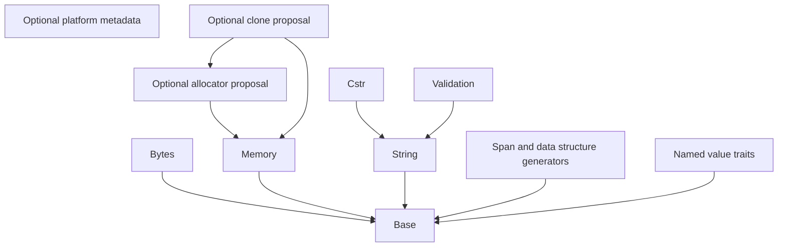

# Framework layers and naming

The dependency direction is from a consumer to its provider. This describes
development source organization, not deployment or standards qualification.

| Boundary | Canonical paths | Responsibility |
| --- | --- | --- |
| Compile-time foundation | `hps/base/all.h`, `hps/base/` | Compiler/language/architecture capabilities and expression helpers; no runtime umbrella dependencies |
| Platform metadata | `hps/platform/detection.h`, `hps/platform/` | Visible OS-family, libc and POSIX evidence; no OS/libc includes, runtime adapter or API guarantee |
| Raw memory | `hps/memory/operations.h` | Byte fill, copy, overlap-safe movement, comparison, search, volatile clearing |
| Static byte reservations | `hps/memory/pool.h` | Single-context fixed byte-block ownership; no general typed-object allocation |
| Optional ownership proposals | `hps/memory/allocator.h`, `hps/memory/clone.h` | Explicit provider interface and element cloning/rollback; HPS-MEM-001 disposition pending |
| Binary sequences | `hps/bytes/` | Borrowed views, capacity/length, cursor and integer codecs |
| Text values | `hps/string/all.h`, `hps/string/` | Counted views, bounded buffers/builders, ASCII and alphabet policy |
| C-string algorithms | `hps/cstr/all.h`, `hps/cstr/` | Bounded NUL-terminated transformations, parsing and formatting |
| Typed spans | `hps/span/define.h`, `hps/span/all.h` | Caller-owned typed read-only span descriptions and constructors |
| Typed containers | `hps/data_structure/define.h`, `hps/data_structure/all.h` | Caller-owned typed container/node descriptions and constructors |
| Named values | `hps/enum/` | Imported enum traits and string-key generators with recorded legacy findings |
| Domain validation | `hps/validation/` | National-code validation over the String contract |

Memory operations and binary sequences are different contracts. The former
touches bytes in caller-proven live objects; the latter validates explicit
descriptor lengths/capacities and maintains logical state. String and Cstr also
retain their distinct counted-text and bounded-C-string contracts. Their existing
libc calls do not acquire a new pool or allocator dependency through this change.

`src/internal/text.h` is implementation-only shared text validation beneath String
and Cstr. Both modules use the same view/error contract; neither reaches into the
other's private directory. The helper implementation is unchanged.

Canonical public includes use `hps/<family>/<operation>.h`; family umbrellas use
`all.h`, while `platform/detection.h` aggregates only platform metadata. Every
implementation lives inside its family directory. The seven old root headers
(`base.h`, `cstr.h`, `string.h`, `span.h`, `data_structure.h`,
`hps_data_structure.h`, `hps_allocator.h`) are thin forwarding includes only.
No second compiler detection system or global runtime umbrella is introduced.
Public macros/constants use `HPS_`, C functions/types use `hps_` or the documented
caller-selected generator prefix. Allocator function/member names require the explicit
[draft migration](../migration/memory.md); the forwarding path does not preserve
the conflicting draft function signatures.

The allocator/clone headers are development proposals, individually included by
opting-in callers. They are not included by Base, Bytes, String, Cstr, descriptors
or the pool, and no compiled core translation unit calls them. They do not enable
a heap provider. Callback-driven allocation remains prohibited in production core
paths by HPS-MEM-001 until separately disposed; merely selecting a static provider
does not approve that departure. See the
[change and proposed exception](../../governance/reviews/memory-layers-2026-10-19.md).

CMake and Meson retain the same runtime dependency graph; `HPS::memory`/`hps-memory`
now contains the raw operation implementation as well as the existing pool.
Header-only proposals use that provider when byte operations are needed.

The nine selected legacy detection files have a
[section-by-section migration record](../migration/detection-environment.md).
Existing IDs remain stable; additional identities/probes do not qualify new
targets. [Platform detection](platform.md) separates family hints from visible
library/API evidence and records include-order/configuration requirements.
